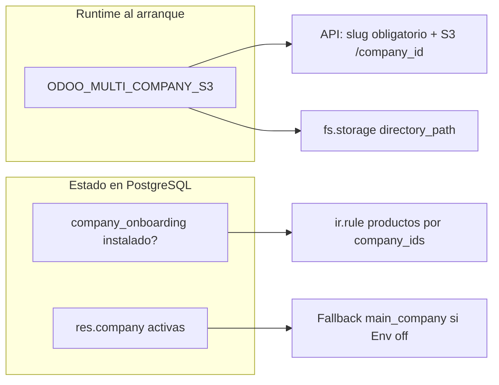

# Modo single-tenant vs multi-company (local)

Guía para **alternar entre modos en el devcontainer** al hacer pruebas. En producción Railway el criterio es otro: **proyecto + Postgres separados** (no mezclar en la misma BD).

- Despliegue Railway (proteger single-tenant): [`DESPLIEGUE_MULTI_COMPANY.md`](DESPLIEGUE_MULTI_COMPANY.md)
- Checklist técnico multi-company: [`RAILWAY_MULTI_COMPANY_CHECKLIST.md`](RAILWAY_MULTI_COMPANY_CHECKLIST.md)
- Plantilla de variables: [`.env.example`](../.env.example) (sección MULTI-COMPANY)
- Prefijos S3 por modo: [`FS_ATTACHMENT_IMAGENES_USUARIO.md`](FS_ATTACHMENT_IMAGENES_USUARIO.md)

---

## 1. Tres capas (no es un solo interruptor)



| Capa | Single-tenant (pruebas típicas) | Multi-company |
|------|----------------------------------|---------------|
| `ODOO_MULTI_COMPANY_S3` | ausente / `false` | `true` |
| `ODOO_EXTRA_INIT_MODULES` | sin `company_onboarding` | `company_onboarding,...` (solo en **primer** `db init`) |
| Módulo `company_onboarding` en BD | **no instalado** | instalado |
| Bucket S3 | p. ej. `odoo-local-dev-attachments` | bucket dedicado + flag `true` |

**Mensaje clave:** cambiar solo `.env` **no** deshace reglas de productos ni el signup público si `company_onboarding` ya está instalado en la BD. El flag controla API (slug) y prefijo S3; el aislamiento de catálogo vive en las `ir.rule` del módulo.

Tras editar `/app/.env`, **reinicia Odoo** (`python3 odoo-bin --dev=all` o el launch de debug). El compose inyecta `.env` al crear el contenedor; `order_bridge` también recarga `.env` al arrancar en local, pero un proceso ya en marcha no ve cambios hasta reiniciar.

---

## 2. Desarrollo local: dos bases de datos

En el mismo Postgres del [devcontainer](../.devcontainer/docker-compose.yml), usa **dos BD** en lugar de reutilizar una BD multi para simular single:

| BD | Uso | Cómo arrancar Odoo |
|----|-----|-------------------|
| `odoo` | Single-tenant local | `PGDATABASE=odoo` + bloque single en `.env` |
| `odoo_multi` | Multi-company local | `PGDATABASE=odoo_multi` + bloque multi en `.env` |

El compose fija por defecto `PGDATABASE=odoo`. Para la BD multi, exporta `PGDATABASE=odoo_multi` en la shell donde lanzas Odoo (o apunta `DATABASE_URL` al nombre correcto).

### Crear la BD multi (una vez)

```bash
# Postgres del compose: host postgres, user/password odoo
createdb -h postgres -U odoo odoo_multi

# Init Odoo (idioma de ejemplo)
python3 odoo-bin db --db_host=postgres -r odoo -w odoo init odoo_multi --language=es_ES

# Instalar onboarding + adjuntos (si no usaste ODOO_EXTRA_INIT_MODULES en un entrypoint Docker)
python3 odoo-bin -d odoo_multi -i company_onboarding,fs_attachment --stop-after-init --no-http
```

En Docker/Railway, el primer boot puede usar `ODOO_EXTRA_INIT_MODULES=company_onboarding,fs_attachment,bi_analytics` (véase `.env.example`). En local con `odoo-bin` directo, el `-i` anterior es equivalente.

### Bloques `.env` (copy-paste)

**Single-tenant** (alinea flag y buckets; no dejes el bucket multi con el flag en `false`):

```bash
ODOO_ATTACHMENT_STORAGE=s3
AWS_DEFAULT_REGION=us-east-1
# AWS_ACCESS_KEY_ID=...
# AWS_SECRET_ACCESS_KEY=...

ODOO_MULTI_COMPANY_S3=false
ORDER_BRIDGE_BANNER_S3_BUCKET=odoo-local-dev-attachments/banners
ODOO_S3_BUCKET=odoo-local-dev-attachments

# No instalar company_onboarding en esta BD
# ODOO_EXTRA_INIT_MODULES=
```

**Multi-company:**

```bash
ODOO_ATTACHMENT_STORAGE=s3
AWS_DEFAULT_REGION=us-east-1
# AWS_ACCESS_KEY_ID=...
# AWS_SECRET_ACCESS_KEY=...

ODOO_MULTI_COMPANY_S3=true
ORDER_BRIDGE_BANNER_S3_BUCKET=odoo-local-dev-multi-tenant-attachments
ODOO_S3_BUCKET=odoo-local-dev-multi-tenant-attachments

# Solo útil en primer boot Docker; en local preferir -i (arriba)
# ODOO_EXTRA_INIT_MODULES=company_onboarding,fs_attachment,bi_analytics
```

Arranque típico:

```bash
# Single
export PGDATABASE=odoo
python3 odoo-bin --dev=all --limit-time-real=0

# Multi (otra shell / tras cambiar .env)
export PGDATABASE=odoo_multi
python3 odoo-bin --dev=all --limit-time-real=0
```

---

## 3. Checklist: cambio de modo local

1. Parar Odoo.
2. Ajustar `.env` (flag + buckets; `ODOO_EXTRA_INIT_MODULES` solo si vas a crear BD nueva vía entrypoint).
3. Elegir BD: `export PGDATABASE=odoo` o `odoo_multi`.
4. Reiniciar Odoo.
5. Verificar:

```bash
# Modo S3 / flag (imprime ODOO_MULTI_COMPANY_S3)
./scripts/verify_s3_storage.sh
```

```sql
SELECT name, state FROM ir_module_module WHERE name = 'company_onboarding';
SELECT id, name, active FROM res_company WHERE active = true;
```

- **API multi** (`ODOO_MULTI_COMPANY_S3=true`): catálogo/register anónimo **sin** slug y con varias compañías → `company_slug_required`.
- **API single** (flag ausente/`false`): sin slug → fallback a `base.main_company` (véase `own_modules/order_bridge/utils/company_context.py`).

---

## 4. Solución de problemas

| Síntoma | Causa probable | Acción |
|---------|----------------|--------|
| AccessError al leer `product.product` (admin, “registros ultrasecretos”) | `company_onboarding` instalado + admin **sin** la compañía del producto en `company_ids` | En Ajustes → Compañías, usa **Entrar** (`action_enter_company`); o entra con el usuario del tenant; o prueba en la BD `odoo` **sin** el módulo |
| API responde `company_slug_required` en “single” | `ODOO_MULTI_COMPANY_S3=true` | Pon `false` o quita la variable y **reinicia** |
| Productos “desaparecen” tras pruebas multi | Reglas globales + productos con `company_id` de tenant | No mezclar: BD `odoo` limpia para single |
| Flag single pero bucket multi (o al revés) | `.env` inconsistente / proceso sin reiniciar | Alinea buckets + flag; reinicia; ver `own_modules/order_bridge/hooks.py` |

### Por qué falla el admin en productos

`company_onboarding` añade reglas globales del estilo `company_id in company_ids` sobre `product.product` / `product.template` ([`company_onboarding_security.xml`](../own_modules/company_onboarding/security/company_onboarding_security.xml)). Al crear compañías por onboarding, el administrador de sistema **no** queda enlazado a esas compañías (aislamiento intencional). Sin **Entrar**, pantallas que leen variantes de producto pueden lanzar AccessError aunque `ODOO_MULTI_COMPANY_S3=false`.

---

## 5. Volver a single en la misma BD (solo emergencia)

La vía limpia es **otra BD** (`odoo` sin el módulo) o un **restore** de dump single-tenant.

Desinstalar `company_onboarding` en una BD que ya tuvo onboarding (reglas, signup, datos de tenants) es **destructivo** y no recomendable en producción. Preferir siempre BD dedicada para cada modo de prueba.

---

## Documentación relacionada

| Documento | Contenido |
|-----------|-----------|
| [DESPLIEGUE_MULTI_COMPANY.md](DESPLIEGUE_MULTI_COMPANY.md) | Proteger producción y crear proyecto Railway multi |
| [RAILWAY_MULTI_COMPANY_CHECKLIST.md](RAILWAY_MULTI_COMPANY_CHECKLIST.md) | Checklist multi-company en Railway |
| [RAILWAY.md](RAILWAY.md) | Despliegue general Railway |
| [FS_ATTACHMENT_IMAGENES_USUARIO.md](FS_ATTACHMENT_IMAGENES_USUARIO.md) | Rutas S3 single vs multi |
| [.env.example](../.env.example) | Plantilla de variables |
