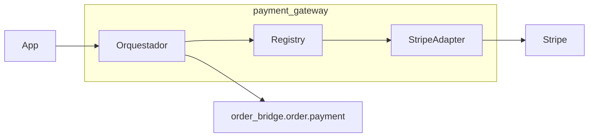
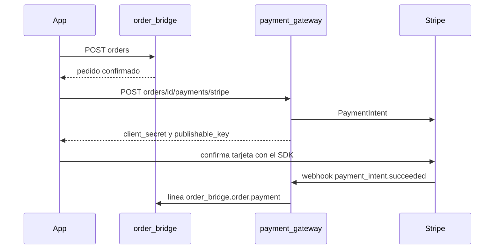

# Plan macro de pagos online (Stripe)

Checklist viva para cobrar algunas órdenes con Stripe (PaymentIntent + SDK) sin cambiar el flujo actual de pedidos de Tienda Apk. Cada punto se implementa después, con su propio plan corto, y solo cuando haga falta.

## Cómo se trabaja

1. Al empezar un punto, escribir un plan corto en [`docs/pagos/`](pagos/) (por ejemplo `docs/pagos/01-modulo-payment-gateway.md`).
2. Implementar solo ese punto.
3. Revisar el código.
4. Marcar el ítem de esta checklist.
5. Abrir el siguiente punto solo entonces.

No se implementa todo junto. Los planes individuales se crean al abrir cada punto; no anticiparlos.

## Lo que ya existe y se mantiene

Los pedidos de Tienda Apk se crean, se confirman y pasan a **Revisando** igual que hoy (`POST /api/order_bridge/orders`). Efectivo y transferencia siguen siendo líneas manuales de `order_bridge.order.payment` con la vía `order_bridge.payment.method` (datos en `own_modules/order_bridge/data/order_bridge_payment_method_data.xml`, pestaña Pagos en `own_modules/order_bridge/views/sale_order_views.xml`).

Hoy, un pedido sin líneas de cobro y sin la marca **Queda por cobrar** se trata como saldado (`order_bridge_amount_due = 0` en `own_modules/order_bridge/models/sale_order.py`). Ese criterio no cambia para pedidos que no entren en Stripe. Al abrir un PaymentIntent, ese pedido concreto pasa a pendiente de cobro hasta que el webhook registre la línea o el intento se cancele.

Referencias:

- [`own_modules/order_bridge/models/order_payment.py`](../own_modules/order_bridge/models/order_payment.py)
- [`own_modules/order_bridge/models/payment_method.py`](../own_modules/order_bridge/models/payment_method.py)
- [`own_modules/order_bridge/models/sale_order.py`](../own_modules/order_bridge/models/sale_order.py)
- [`own_modules/order_bridge/models/transfer.py`](../own_modules/order_bridge/models/transfer.py)

## Dónde vive Stripe

Stripe va en un módulo nuevo, `own_modules/payment_gateway`, que **depende de** `order_bridge`. `order_bridge` no lo declara en `depends` y no importa Stripe. El nombre es el del gateway: Stripe es el primer proveedor dentro de ese módulo. Otro proveedor, cuando exista, entra en el mismo módulo (otra clase en `providers/`, otro registro y otra ruta de webhook) siguiendo la interfaz del punto 2.

Efectivo, transferencia, la pestaña Pagos y el saldo (`order_bridge.payment.method`, `order_bridge.order.payment`, `order_bridge_amount_due`) se quedan en `order_bridge`. `transfer.py` reparte una transferencia entre pedidos con deuda creando esas líneas. Sacar ese libro de cobros a otro módulo obligaría a renombrar modelos, migrar tablas y xmlids, y a que la mensajería llame al módulo nuevo. Eso es un refactor del flujo que ya funciona, y no hace falta para cobrar con tarjeta.

`order_bridge` no depende de `payment_gateway`. Así Tienda Apk sigue arrancando sin el gateway, y el webhook y las claves quedan en el módulo que cobra online. En Odoo el módulo de la función depende de la base (`sale` no depende de `payment_stripe`).

`payment_gateway`, cuando el pago se confirma, escribe una línea `order_bridge.order.payment` con la vía Stripe. El intento de pago (PaymentIntent, estado, id externo) vive solo en `payment_gateway`.

## Arquitectura del gateway

Tres piezas, sin jerarquía extra:

- **Strategy.** Clase base `PaymentProvider` con dos operaciones: `start_payment` (abre el cobro remoto y devuelve id externo más lo que el SDK necesita, p. ej. `client_secret`) y `parse_webhook` (verifica la firma del cuerpo crudo y devuelve un evento normalizado: id externo, estado `succeeded` o `failed`, importe).
- **Registry.** `register` / `get(code)`. El controlador y el servicio piden el proveedor por código (`stripe`). Añadir otro proveedor es una clase nueva en `providers/<code>.py` más un registro. No hay un módulo Odoo por proveedor.
- **Adapter.** Cada clase concreta traduce su API (Stripe hoy) a esos dos resultados. El resto del módulo no importa tipos de Stripe.

El **orquestador** (mismo para todos) queda fuera del proveedor: autenticar el dispositivo, calcular el importe, marcar **Queda por cobrar**, y, ante un evento `succeeded`, escribir una sola línea `order_bridge.order.payment`. Así el libro de cobros de Tienda Apk no se duplica en cada proveedor.

La interfaz se define en el punto 2 (esqueleto). Stripe la implementa en los puntos de PaymentIntent y webhook. Un segundo proveedor concreto sigue fuera de estas fases; lo que entra ahora es la forma de añadirlo igual.

## Decisiones ya cerradas

- Stripe cobra **después** de crear el pedido. El cliente elige pagar esa orden online; el resto de órdenes no pasa por Stripe.
- La primera versión útil es **PaymentIntent + SDK** (formulario de tarjeta en la APK o la web). Los datos de tarjeta los recoge Stripe; esta API solo devuelve `client_secret` y la clave publicable.
- El pago confirmado se registra como un cobro más en la pestaña Pagos, con una vía **Stripe**.
- El módulo estándar `payment` / `payment_stripe` de Odoo queda fuera de estas fases. El cobro de tienda sigue en `order_bridge.order.payment`.
- Los proveedores online de `payment_gateway` comparten Strategy, Registry y Adapter; el orquestador escribe el cobro en `order_bridge`.

## Fuera de estas fases

Reembolsos, guardar tarjetas, pagos online parciales, un segundo proveedor concreto, conciliar facturas contables y la pantalla del cliente (la app no está en este repositorio; aquí solo el contrato HTTP).

## Flujo objetivo

## Checklist

- [x] **0. Este documento.** `docs/PAGOS_ONLINE.md` con la checklist y la regla de un punto cada vez. Los planes individuales se crean al abrir el punto, en `docs/pagos/`.
- [x] **1. Módulo `payment_gateway`.** Manifiesto con `depends: ['order_bridge']`, sin que `order_bridge` dependa de él. Dato de la vía de pago Stripe sobre el modelo que ya existe. Sin llamadas a Stripe y sin cambiar la creación de pedidos. El campo `code` en la vía de pago se añade aquí solo si el módulo lo necesita para localizar la vía; efectivo y transferencia no se mueven. Plan individual al abrir: `docs/pagos/01-modulo-payment-gateway.md`.
- [x] **2. Arquitectura del gateway.** Esqueleto en `own_modules/payment_gateway/`: `providers/base.py` (`PaymentProvider` con `start_payment` y `parse_webhook`), `providers/registry.py` (`register` / `get(code)`) y orquestador vacío que resuelve por `code`. Sin HTTP a Stripe, sin secretos y sin modelo de intento. Plan individual al abrir: `docs/pagos/02-arquitectura-gateway.md`.
- [x] **3. Secretos y moneda.** Variables de entorno de prueba (`STRIPE_SECRET_KEY`, `STRIPE_PUBLISHABLE_KEY`, `STRIPE_WEBHOOK_SECRET`) documentadas en [`.env.example`](../.env.example). Comprobar que la moneda del pedido la acepta Stripe antes de crear intents. Aún no se cobra. Plan individual al abrir: `docs/pagos/03-secretos-y-moneda.md`.
- [x] **4. PaymentIntent de un pedido ya creado.** En `payment_gateway`: modelo de intento (pedido, id de Stripe, estado, importe) y endpoint autenticado con el dispositivo del pedido (reutiliza el auth de `order_bridge`). Importe calculado en el servidor (total menos cobros ya registrados; si no hay cobros, el total). Al crear el intento, ese pedido queda **Queda por cobrar**. Si ya está cubierto por efectivo o transferencia, se rechaza. El adaptador Stripe implementa `start_payment`. Plan individual al abrir: `docs/pagos/04-payment-intent.md`.
- [x] **5. Webhook firmado.** Ruta en `payment_gateway` que verifica la firma sobre el cuerpo crudo vía `parse_webhook` del proveedor. `payment_intent.succeeded` crea una sola línea `order_bridge.order.payment` (reintentos del webhook no duplican). Un intento fallido actualiza el estado y no crea cobro. Plan individual al abrir: `docs/pagos/05-webhook.md`.
- [ ] **6. Estado para la app.** Endpoint de `payment_gateway`, con el mismo Bearer del dispositivo, que expone cobrado, pendiente y el estado del intento. `client_secret` solo para el dispositivo dueño y solo mientras el intento siga abierto. Meter esos campos en el JSON de `GET /api/order_bridge/orders/<id>` queda para cuando la app lo pida; si hace falta, será un método vacío en `sale.order` que `payment_gateway` rellena, sin lógica de Stripe dentro de `order_bridge`. Plan individual al abrir: `docs/pagos/06-estado-app.md`.
- [ ] **7. Contrato para la app.** Sección corta en este doc (o en `docs/pagos/`) con el flujo del SDK, la clave publicable, los errores y la regla de no enviar datos de tarjeta a Odoo. La APK y la web se implementan en su repo. Plan individual al abrir: `docs/pagos/07-contrato-app.md`.
- [ ] **8. Prueba manual en modo test.** Un pedido creado como siempre, pago con tarjeta de prueba, cobro visible en la pestaña Pagos, y un pedido sin Stripe que sigue igual (saldado si nadie marcó pendiente ni registró cobros). Plan individual al abrir: `docs/pagos/08-prueba-manual.md`.

Al cerrar el punto 8 el sistema tiene una vía online real. Un segundo proveedor se añade dentro de `payment_gateway` como otra clase en `providers/`, con registro y webhook propios, y escribe la misma línea de cobro a través del orquestador.

## Siguiente paso

Abrir el **punto 6**: plan corto en `docs/pagos/06-estado-app.md` (endpoint Bearer con cobrado, pendiente y estado del intento; `client_secret` solo si el intento sigue abierto).
