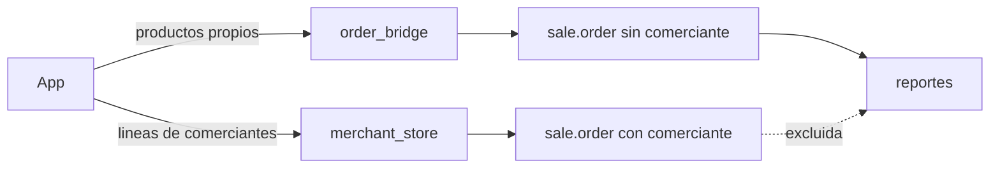

# Plan macro de comercios en la tienda

Checklist viva para vender productos de otros comerciantes sin mezclarlos con Tienda Apk ni con los reportes del negocio. Cada punto se implementa después, con su propio plan corto, y solo cuando haga falta.

## Cómo se trabaja

1. Al empezar un punto, escribir un plan corto en esta carpeta (por ejemplo [`01-modulo-vacio.md`](01-modulo-vacio.md)).
2. Implementar solo ese punto.
3. Revisar el código.
4. Marcar el ítem de esta checklist.
5. Abrir el siguiente punto solo entonces.

No se implementa todo junto. Los planes individuales se crean al abrir cada punto; no anticiparlos.

## Lo que ya existe y no se toca

Los pedidos del negocio siguen en Tienda Apk (`own_modules/order_bridge`): `POST /api/order_bridge/orders` crea un `sale.order` con `order_bridge_origin` y el estado de tienda en [`own_modules/order_bridge/utils/constant.py`](../../own_modules/order_bridge/utils/constant.py) (Revisando, Negociando, Listo para entrega, Entregado, Cancelado). El catálogo público es `product.template` con `order_bridge_visible`.

Los reportes de [`own_modules/bi_analytics`](../../own_modules/bi_analytics) leen `sale.order` con `state = 'sale'` ([`product_sale_report.py`](../../own_modules/bi_analytics/models/product_sale_report.py), [`profitability_report.py`](../../own_modules/bi_analytics/models/profitability_report.py)). El análisis estándar de Ventas (`sale.report`) no filtra por estado en el SQL. `merchant_store` los hereda y excluye las órdenes con comerciante. `bi_analytics` no depende del módulo nuevo.

`order_bridge` no depende de `merchant_store`. El menú de Tienda Apk ya exige `order_bridge_origin` ([`order_bridge_menu.xml`](../../own_modules/order_bridge/views/order_bridge_menu.xml)). Las subórdenes no llevan ese origen, así que no entran. El catálogo (`_order_bridge_product_domain` en [`res_company.py`](../../own_modules/order_bridge/models/res_company.py)) se estrecha desde `merchant_store` para dejar fuera productos con comerciante.

Referencias:

- [`own_modules/order_bridge/models/sale_order.py`](../../own_modules/order_bridge/models/sale_order.py)
- [`own_modules/order_bridge/models/product_template.py`](../../own_modules/order_bridge/models/product_template.py)
- [`own_modules/order_bridge/controllers/orders.py`](../../own_modules/order_bridge/controllers/orders.py)
- [`own_modules/order_bridge/utils/company_context.py`](../../own_modules/order_bridge/utils/company_context.py)
- [`own_modules/company_onboarding/security/company_onboarding_security.xml`](../../own_modules/company_onboarding/security/company_onboarding_security.xml)

## Dónde vive

Módulo nuevo `own_modules/merchant_store`. Depende de `order_bridge` solo para reutilizar el dispositivo (Bearer) y el partner del cliente. La tienda arranca sin él.

Los comerciantes no son `res.company`. El tenant ya es la compañía (`company_onboarding`, slug de Tienda Apk). Una compañía por comerciante los metería en el conmutador y en los informes de otro negocio.

## Decisiones cerradas

- **Productos y subórdenes son los de Odoo.** `product.template` con `merchant_id`, y `sale.order` con el mismo campo (una por comerciante). Así siguen disponibles impuestos, tarifas, unidades, variantes, stock, albaranes y facturas cuando hagan falta. El módulo nuevo no reimplementa el pedido ni el producto; añade el comerciante, el reparto del carrito y sus pantallas.
- **No se mezclan.** Sin `order_bridge_origin`, sin `order_bridge_visible` y sin `available_in_pos`. `merchant_store` excluye `merchant_id` del catálogo de Tienda Apk, de la acción de Ventas, de la de Productos y de los reportes (`bi_analytics` y `sale.report`). Esas órdenes solo se abren desde el menú del módulo nuevo.
- **Estas fases no confirman la suborden ni mueven stock.** El estado de tienda (el campo que ya existe) avanza igual, en cada suborden por su cuenta. Confirmar, reservar y facturar queda para después, sobre el mismo `sale.order`.
- **Compra mixta.** La app sigue creando el pedido del negocio solo con productos propios, por la API actual. Las líneas de otros comerciantes van a la API nueva, que crea las subórdenes. Si el carrito no tiene productos propios, no hay pedido de Tienda Apk. Si no tiene líneas de comerciantes, no se llama al módulo nuevo.
- **Un checkout, N subórdenes.** `client_checkout_id` agrupa las `sale.order` de comerciantes y puede guardar el id del pedido de Tienda Apk. El módulo nuevo no escribe ese pedido. El estado de cada suborden no cambia el del pedido propio.
- **Historial agrupado del cliente.** `GET /api/merchant_store/purchases` agrupa el pedido de Tienda Apk (si existe) con sus subórdenes, y agrupa por `client_checkout_id` las compras solo de comerciantes (`order: null`). Cada suborden expone `merchant_name`. Las rutas existentes de `order_bridge` y `merchant_store` mantienen compatibilidad con apps viejas.
- **Aislados por compañía.** El comerciante, sus productos y sus subórdenes llevan `company_id` de la tienda (nunca vacío: con `company_onboarding` la regla de producto es `company_id in company_ids`). Regla `ir.rule` en el comerciante, igual que el dispositivo. En single-tenant es la compañía principal y el slug no hace falta. En multi-tenant, la API usa la compañía del dispositivo (el mismo slug / `X-Company-Slug` que Tienda Apk). Las rutas públicas van con `sudo()` y por eso filtran `company_id` a mano: un dispositivo de la compañía A no lista ni compra comerciantes, productos ni pedidos de B. El enlace al pedido de Tienda Apk tiene que ser de esa misma compañía.
- **Aislados entre comerciantes de la misma tienda.** Un producto solo entra en la suborden de su comerciante. El personal de la compañía ve los comerciantes de la suya. No hay portal del comerciante en estas fases.
- **Quién opera.** El personal de la compañía, en menús del módulo nuevo. Sin usuario Odoo ni portal por comerciante en estas fases.
- **Comerciante.** Nombre, descripción, logo, `company_id` y `active` (true por defecto). Productos y subórdenes solo de ese comerciante. La API solo publica comerciantes activos.
- **Imágenes en S3.** Toda imagen de usuario de Comercios (logo del comerciante, fotos de producto y las que se añadan después) va al mismo `fs.storage` S3 que Tienda Apk (`s3_order_bridge_banners`), vía `field_xmlids` descubiertos por `order_bridge.hooks.provision_media_fs_storage`, separada en subcarpetas por comerciante (`merchants/{merchant_id}/logo/` y `merchants/{merchant_id}/products/{product_tmpl_id}/`) mediante el hook sobre `ir.attachment._get_fs_path`. Campos `fields.Image` (o binario con nombre de media y `attachment=True`); sin bucket nuevo y sin marcar el storage como default de todos los adjuntos.
- **App opcional por compañía.** Con `company_onboarding`, Comercios se enciende en la pestaña Aplicaciones (`code`: `merchant_store`), apagada por defecto. El menú raíz se oculta hasta marcar la casilla. En single-tenant sin ese módulo, basta instalar `merchant_store`.

## Fuera de estas fases

Confirmar la suborden, stock, costo, facturas, comisión, liquidación al comerciante, cobro Stripe de las subórdenes, mensajería, mensajero, push y portal del comerciante. Esas piezas salen del `sale.order` y del `product.template` cuando se abran; no se modelan ahora. El cobro online del pedido propio sigue en `payment_gateway` como hoy.

## Checklist

- [x] **0. Este documento.** `docs/comercios/COMERCIOS.md` con la checklist y la regla de un punto cada vez. Los planes individuales se crean al abrir el punto, en esta carpeta.
- [x] **1. Módulo vacío.** `merchant_store` con `depends: ['order_bridge']`, seguridad y menú raíz. Sin modelos de negocio. `order_bridge` no cambia. App opcional por compañía. Plan: [`01-modulo-vacio.md`](01-modulo-vacio.md).
- [x] **2. Comerciante.** Modelo con nombre, descripción, logo y `company_id`. Regla multi-compañía. Listado y formulario solo en este módulo, acotados a la compañía del usuario. Plan: [`02-comerciante.md`](02-comerciante.md).
- [x] **3. Productos del comerciante.** `product.template` con `merchant_id`. Nombre, precio, imagen y activo. Fuera del catálogo de Tienda Apk, del TPV y del menú de productos del negocio. Plan: [`03-productos.md`](03-productos.md).
- [x] **4. Subórdenes.** Una `sale.order` por comerciante, sin `order_bridge_origin`, con líneas y el estado de tienda que ya existe (Revisando → … → Entregado / Cancelado), independiente del pedido propio. Pantallas solo en este módulo. La acción de Ventas las excluye. No se confirman. Los reportes de `bi_analytics` y `sale.report` ignoran `merchant_id`. Plan: [`04-subordenes.md`](04-subordenes.md).
- [x] **5. Compra mixta.** `client_checkout_id` idempotente y enlace opcional al `sale.order` de Tienda Apk que la app ya creó. Esta API rechaza un producto sin comerciante. El dominio del catálogo de Tienda Apk, heredado desde aquí, rechaza un producto con comerciante. Plan: [`05-compra-mixta.md`](05-compra-mixta.md).
- [x] **6. API.** Bearer del dispositivo ya registrado. La compañía es la del dispositivo (slug como Tienda Apk; en single-tenant, la principal). Listar solo comerciantes activos y productos de esa compañía; crear la compra partiéndola por comerciante, sin aceptar un producto de otra compañía, de un comerciante archivado ni de otro comerciante en la suborden equivocada; consultar subórdenes y estado de esa compañía. Misma forma que `order_bridge`: rutas `/api/merchant_store/`, Pydantic, CORS. Plan individual al abrir: [`06-api.md`](06-api.md).
- [x] **7. Contrato para la app.** `openapi.json` generado como [`own_modules/order_bridge/scripts/export_openapi.py`](../../own_modules/order_bridge/scripts/export_openapi.py), más un prompt corto en esta carpeta para adaptar el cliente: carrito partido en dos llamadas, ids de producto distintos, estados de las subórdenes aparte del pedido propio. Plan: [`07-contrato-app.md`](07-contrato-app.md).
- [x] **8. Listado único de compras del cliente.** `GET /api/merchant_store/purchases` que agrupa pedido de Tienda Apk + subórdenes (y compras solo de comercio con `order: null`), más `merchant_name` en cada suborden sin romper apps viejas. Plan: [`08-listado-cliente.md`](08-listado-cliente.md).
- [ ] **9. Prueba manual.** Compra con líneas propias y de dos comerciantes: el pedido propio sigue en Tienda Apk con su estado; cada comerciante tiene su suborden y su flujo; un informe de `bi_analytics` no incluye esas líneas ni esos productos. En multi-tenant, un dispositivo de otra compañía no ve esos comerciantes ni puede comprarlos. Plan individual al abrir: `09-prueba-manual.md`.

## Siguiente paso

Abrir el **punto 9** con un plan corto en `09-prueba-manual.md` y ejecutar la prueba manual de punta a punta.

