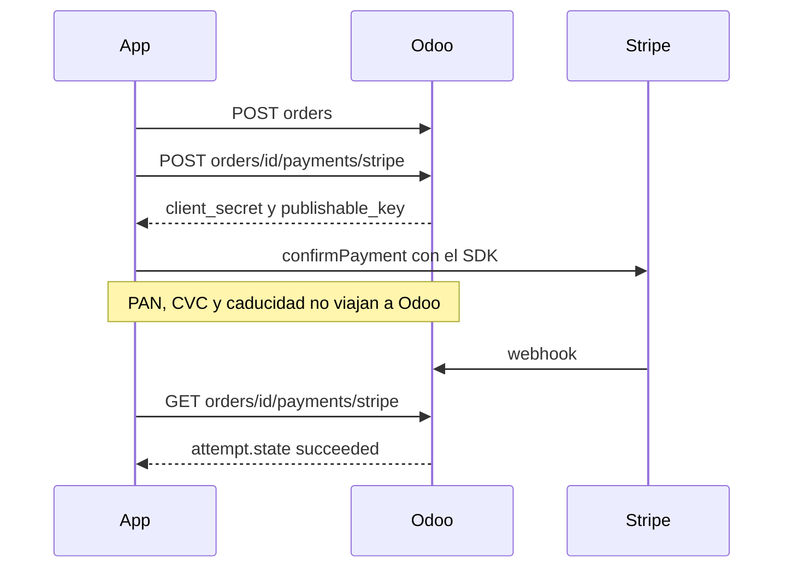

# 07 — Contrato HTTP para la app (Stripe)

Contrato del punto 7 de [`docs/PAGOS_ONLINE.md`](../PAGOS_ONLINE.md). La APK y la web se implementan en su repo; aquí solo el contrato hacia Odoo. Sin cambios de código en este punto.

## Auth

Igual que el resto de Tienda Apk: cabecera `Authorization: Bearer <device_key>`. Solo el dispositivo de `order_bridge_device_id` del pedido. Otro dispositivo o pedido inexistente → 404. Sin Bearer o clave inválida → 401.

## Flujo



1. Crear el pedido como siempre (`POST /api/order_bridge/orders`).
2. Si el cliente elige pagar online: `POST /api/order_bridge/orders/<id>/payments/stripe` (cuerpo vacío).
3. Inicializar el SDK de Stripe con `publishable_key` y confirmar el PaymentIntent con `client_secret`. Los datos de tarjeta los recoge Stripe.
4. El éxito del SDK no es el cobro. La línea de Pagos la escribe el webhook de Stripe a Odoo.
5. Consultar `GET /api/order_bridge/orders/<id>/payments/stripe` hasta `attempt.state == succeeded` (o `failed`).

## Regla de tarjeta

Odoo no acepta número de tarjeta, CVC ni caducidad. Esos datos van solo al SDK de Stripe. `STRIPE_SECRET_KEY` y `STRIPE_WEBHOOK_SECRET` no salen en ninguna respuesta. `client_secret` y `publishable_key` sí van al dispositivo dueño mientras el intento esté abierto.

## POST — abrir PaymentIntent

`POST /api/order_bridge/orders/<id>/payments/stripe`

Cuerpo vacío. El importe lo calcula el servidor (total del pedido menos cobros ya registrados). Si no hay cobros, el total. Mismo saldo reutiliza el intento abierto; saldo distinto cancela el anterior y abre otro.

**200**

```json
{
  "provider": "stripe",
  "external_id": "pi_...",
  "client_secret": "pi_..._secret_...",
  "publishable_key": "pk_test_...",
  "amount": 100.0,
  "currency": "mxn"
}
```

## GET — estado del cobro

`GET /api/order_bridge/orders/<id>/payments/stripe`

**200 sin intento**

```json
{
  "provider": "stripe",
  "amount_paid": 0.0,
  "amount_due": 0.0,
  "currency": "mxn",
  "attempt": null
}
```

(`amount_due` sigue la regla de Tienda Apk: 0 si nadie marcó pendiente ni hay líneas de cobro.)

**200 con intento abierto**

```json
{
  "provider": "stripe",
  "amount_paid": 0.0,
  "amount_due": 100.0,
  "currency": "mxn",
  "attempt": {
    "state": "open",
    "external_id": "pi_...",
    "amount": 100.0,
    "client_secret": "pi_..._secret_...",
    "publishable_key": "pk_test_..."
  }
}
```

**200 con intento cerrado** (`succeeded`, `failed` o `canceled`): mismos campos de estado (`state`, `external_id`, `amount`) sin `client_secret` ni `publishable_key`.

Estados de `attempt.state`: `open`, `succeeded`, `failed`, `canceled`.

## Errores (app)

| HTTP | `error` | Cuándo |
|------|---------|--------|
| 401 | `unauthorized` | Bearer ausente o inválido |
| 404 | `not_found` | Pedido inexistente u otro dispositivo |
| 400 | `validation` | Pedido cancelado, saldo ya cubierto, o moneda que Stripe no admite |
| 502 | `provider_error` | Stripe no pudo abrir el intento (solo POST) |
| 503 | `configuration` | Faltan claves; en GET solo si el intento sigue abierto |

Cuerpo típico de error con mensaje: `{"error": "...", "message": "..."}`. El 404 simple puede ser solo `{"error": "not_found"}`.

## Fuera del contrato de la app

- `POST /api/payment_gateway/stripe/webhook` — solo Stripe.
- Campos de pago en `GET /api/order_bridge/orders/<id>`.
- Reembolsos, tarjetas guardadas, pagos online parciales, segundo proveedor.
- Implementación de la APK o la web.
