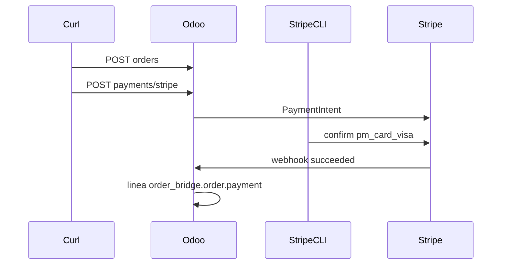

# 08 — Prueba manual en modo test

Plan corto del punto 8 de [`docs/PAGOS_ONLINE.md`](../PAGOS_ONLINE.md). Prueba de punta a punta con claves Stripe de test. Sin rutas, modelos ni proveedores nuevos.

## Objetivo

Cobrar un pedido con tarjeta de prueba y comprobar que la línea Stripe aparece en la pestaña Pagos. Un segundo pedido, sin Stripe, sigue saldado (pendiente 0 si nadie marcó cobro pendiente ni hay líneas).

## Decisiones

- **Dos pedidos.** Ambos se crean como hoy: `POST /api/order_bridge/orders` con `Authorization: Bearer` del dispositivo. Quedan en **Revisando**.
- **Pedido A (con Stripe).** `POST /api/order_bridge/orders/<id>/payments/stripe` (cuerpo vacío). La tarjeta no pasa por Odoo: el PaymentIntent se confirma con la CLI de Stripe y el método de prueba `pm_card_visa` (tarjeta 4242 del modo test). `stripe listen` reenvía `payment_intent.succeeded` a `POST /api/payment_gateway/stripe/webhook`.
- **Pedido B (sin Stripe).** No llama a Stripe. Sin líneas y sin **Queda por cobrar**, `order_bridge_amount_due` sigue en 0.
- **Casilla pendiente.** El webhook no apaga `order_bridge_payment_pending` (solo crea la línea y pasa el intento a `succeeded`). Tras el cobro, **Pendiente de cobro** queda en 0 porque el cobro cubre el total; la casilla puede seguir marcada. Eso no es un fallo de esta prueba.

## Requisitos

Comprobarlos antes de crear pedidos. Si falta alguno, parar y decir cuál: no inventar claves y no marcar el ítem 8.

- Odoo local con `payment_gateway` instalado y las tres claves de test en Tienda Apk → Configuración → Stripe para la compañía principal (`secret_key`, `publishable_key`, `webhook_secret`; ver [`03-secretos-y-moneda.md`](03-secretos-y-moneda.md)).
- Moneda de la compañía en la lista de presentment de Stripe (en esta base, USD).
- CLI de Stripe en la misma cuenta test que la `secret_key` guardada.
- `stripe listen --forward-to <odoo>/api/payment_gateway/stripe/webhook`. El `whsec_` que imprime hay que pegarlo en el campo webhook secret de esa compañía (no en variables de entorno).

## Qué no entra

Reembolsos, la APK, campos de pago en `GET /api/order_bridge/orders/<id>`, un segundo proveedor, cambios de código en el gateway (salvo un defecto que bloquee la prueba).

## Verificación

### Pedido A

1. `POST /api/order_bridge/register` (`device_key`, teléfono de 8 dígitos) y `POST /api/order_bridge/orders` con un producto visible del catálogo.
2. `POST .../payments/stripe` → `client_secret`, `publishable_key` `pk_test_...`, importe = total.
3. `GET .../payments/stripe` → `attempt.state` `open`, pendiente = total.
4. `stripe payment_intents confirm <external_id> --payment-method pm_card_visa`.
5. `GET` de nuevo → `succeeded`, sin `client_secret` ni `publishable_key`, cobrado = total, pendiente 0.
6. En el formulario del pedido, pestaña Pagos: una línea, vía **Stripe**, importe = total. Un segundo reenvío del webhook no añade otra línea.

### Pedido B

Mismo dispositivo, otro `client_order_id`, sin POST a Stripe:

1. `GET .../payments/stripe` → `attempt: null`, cobrado 0, pendiente 0.
2. Pestaña Pagos: sin líneas y sin **Queda por cobrar**.

## Cierre

Si ambos pedidos cumplen lo anterior, marcar el ítem 8 en [`docs/PAGOS_ONLINE.md`](../PAGOS_ONLINE.md). La vía online queda probada; un segundo proveedor entra después como otra clase en `providers/`.
